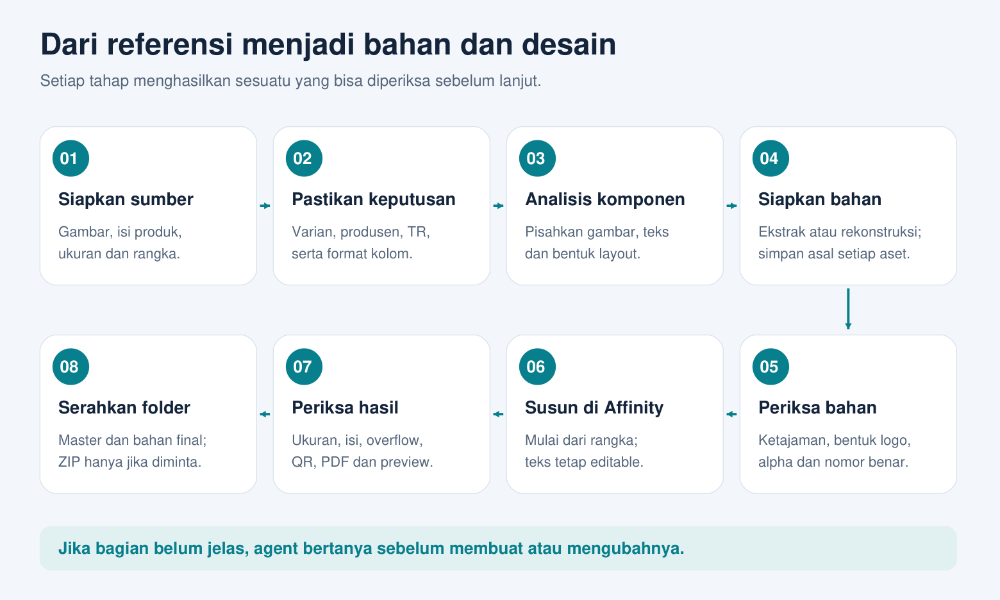
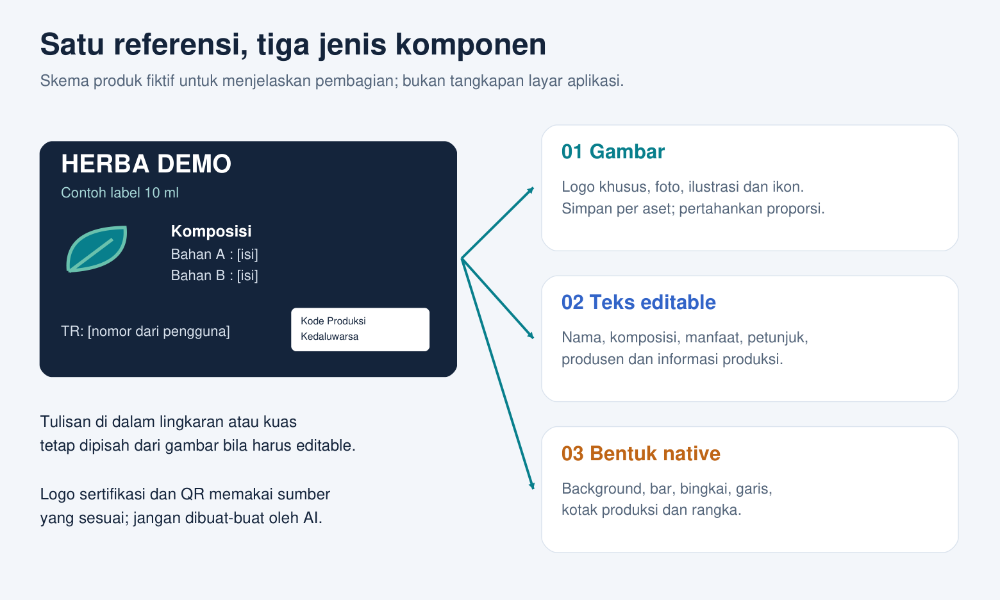
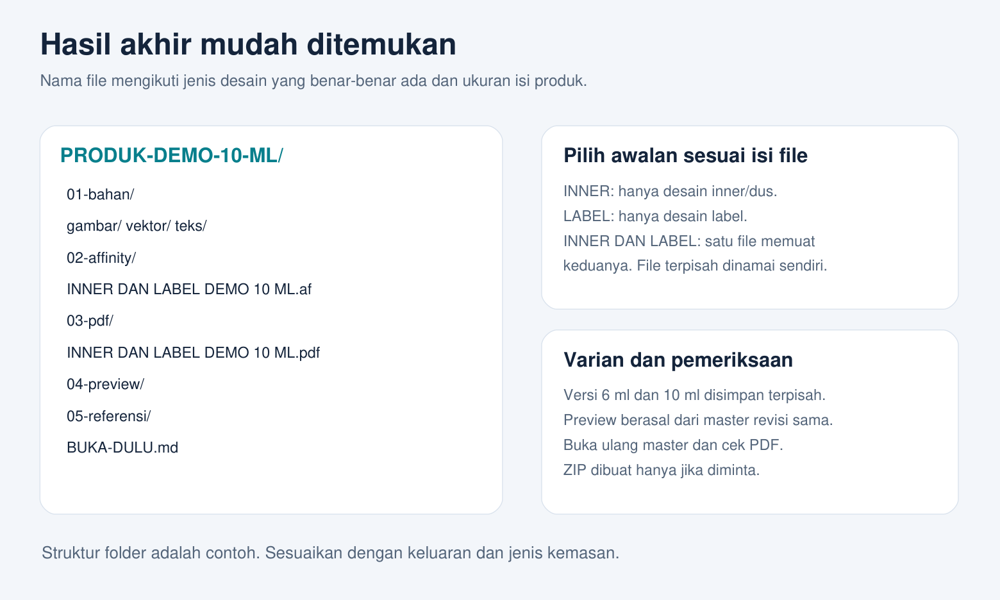

# Skill Desain Kemasan

Dari gambar referensi menjadi **bahan desain terpisah**, lalu **master kemasan yang bisa dikerjakan di Affinity**. Skill berbahasa Indonesia ini membantu analisis komponen, transkripsi teks, adaptasi ukuran, penyusunan, revisi, dan pemeriksaan hasil.



> Skill adalah panduan kerja untuk agent AI. Memasang folder ini tidak otomatis memasang Affinity, konektor MCP, atau tool pembuat gambar.

## Mulai dari sini

| Saya ingin… | Baca |
| --- | --- |
| Tahu apa saja yang harus disiapkan | [Persiapan bahan dan perangkat](docs/01-persiapan.md) |
| Memasang skill dan mengecek koneksi | [Instalasi dan koneksi](docs/02-instalasi-dan-koneksi.md) |
| Memahami urutan pengerjaan | [Alur kerja langkah demi langkah](docs/03-alur-pengerjaan.md) |
| Menyalin contoh prompt dan meminta revisi | [Contoh penggunaan](docs/04-contoh-dan-revisi.md) |
| Mengatasi masalah umum | [Pemecahan masalah](docs/05-troubleshooting.md) |
| Mengisi data proyek sebelum mulai | [Template brief](examples/brief-produk.md) |

## Yang perlu tersedia

- **Agent AI** yang dapat memuat skill, membaca gambar, dan mengakses file proyek.
- **Gambar referensi atau brief**, nama produk, varian isi, dan teks yang benar.
- **Rangka/ukuran terukur** bila meminta layout berdimensi atau desain di Affinity.
- **Affinity dan koneksi MCP yang berfungsi** bila meminta agent menyusun file native.
- **Tool gambar** bila aset perlu dibuat atau direkonstruksi dengan AI. Aset yang sudah baik bisa dipakai kembali.
- **Python 3** hanya untuk helper geometri/inspeksi; Pillow opsional untuk inspeksi gambar.

Lihat [tabel kebutuhan per jenis pekerjaan](docs/01-persiapan.md#perangkat-dan-tool) agar tidak memasang sesuatu yang belum diperlukan.

## Instalasi singkat

Salin seluruh repositori sebagai satu folder bernama `kemasan-desain`, bukan hanya `SKILL.md`. Untuk Codex saat ini, lokasi pengguna yang didokumentasikan adalah `~/.agents/skills/`; lihat [panduan resmi skills](https://learn.chatgpt.com/docs/build-skills). Instruksi Windows dan cara memverifikasi pemasangan ada di [panduan instalasi](docs/02-instalasi-dan-koneksi.md).

```text
kemasan-desain/
├── SKILL.md
├── agents/
├── references/
├── scripts/
├── tests/
├── docs/
└── examples/
```

## Permintaan pertama

```text
Gunakan $kemasan-desain untuk produk [NAMA PRODUK] ukuran [ISI].
Referensi: [unggah gambar atau berikan path yang dapat diakses].
Rangka: [file rangka dan ukuran yang digunakan].

Analisis gambar terlebih dahulu. Pisahkan teks, gambar, dan bentuk.
Siapkan serta periksa semua bahan sebelum merakit di Affinity.
Tanyakan bagian yang ambigu, nomor TR, produsen CV/PT, dan format
kolom produksi/kedaluwarsa bila belum saya tentukan.
Simpan hasil di [FOLDER TUJUAN], tanpa ZIP otomatis.
```

Gunakan istilah/nomor yang relevan dengan produk Anda. Produk yang tidak memerlukan TR atau kolom kedaluwarsa tidak perlu ditambah kolom tersebut hanya karena contoh prompt menyebutnya.

## Cara komponen dipisahkan



Informasi produk menjadi teks editable. Foto, ilustrasi, dan logotype khusus dapat menjadi gambar terpisah. Background, bar, kotak, garis, dan rangka cocok menjadi bentuk native. Jika batas komponen tidak jelas, agent perlu bertanya sebelum generate.

## Hasil yang diterima



Nama file mengikuti isinya: `INNER`, `LABEL`, atau `INNER DAN LABEL`, kemudian nama produk dan ukuran isi. Varian disimpan terpisah. Folder berisi master, bahan, PDF/preview sesuai permintaan, dan penunjuk versi terbaru. **ZIP hanya dibuat jika diminta.**

Gambar dokumentasi adalah skema buatan untuk menjelaskan alur, bukan screenshot aplikasi atau aset produk siap cetak. Sumber SVG tersedia bersama PNG di [docs/images](docs/images).

## Helper dan pemeriksaan kode

```bash
python scripts/layout_geometry.py cylinder --diameter 57 --height 51 --overlap 3
python scripts/package_assets.py inspect path/to/image.png
python -m unittest discover -s tests
```

Perhitungan tidak membuktikan bentuk botol nyata atau kesiapan produksi. Petunjuk cetak/bleed mengikuti data proyek dan percetakan. [Pelajari batas helper](docs/02-instalasi-dan-koneksi.md#helper-python-opsional).

Instruksi untuk agent ada di [SKILL.md](SKILL.md). Dokumentasi pengguna ini tidak menggantikan keputusan proyek atau ketersediaan tool pada agent.
