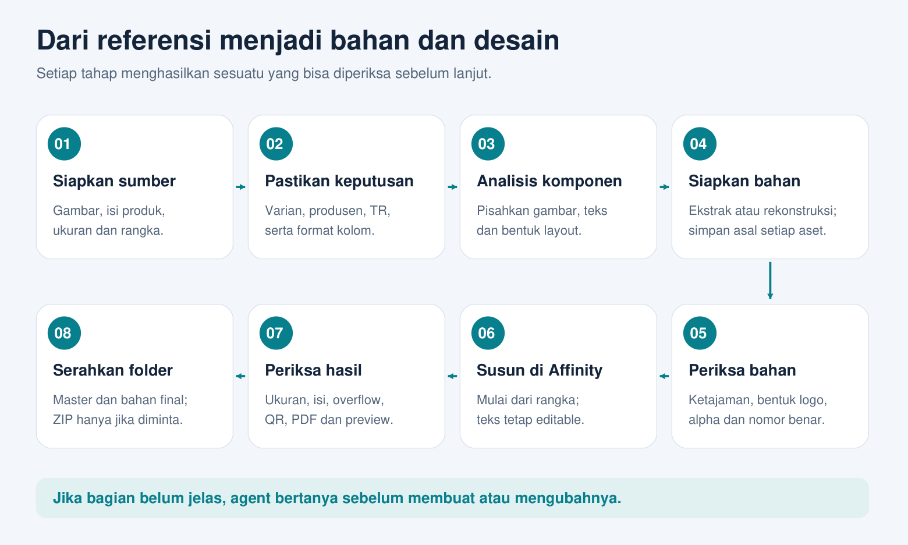
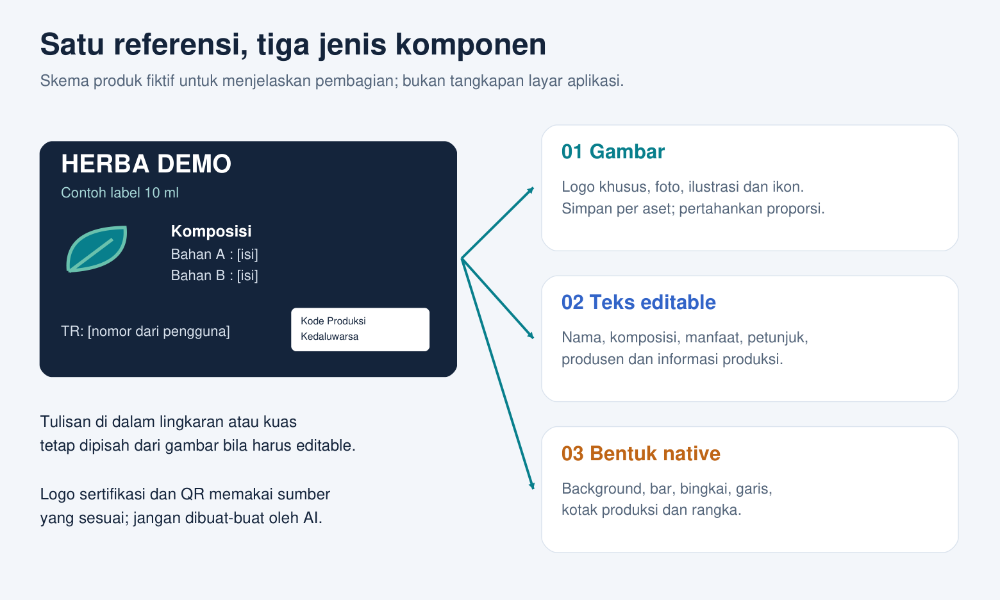
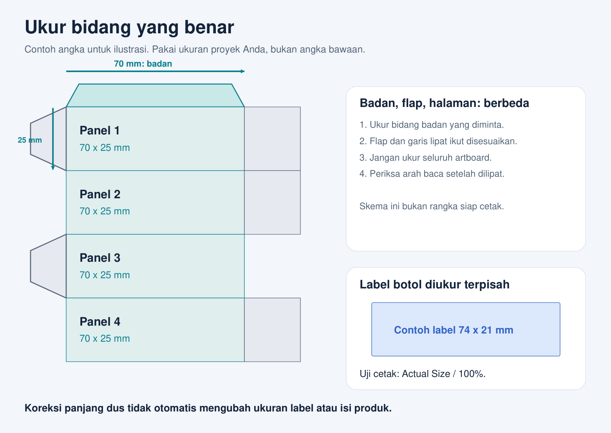
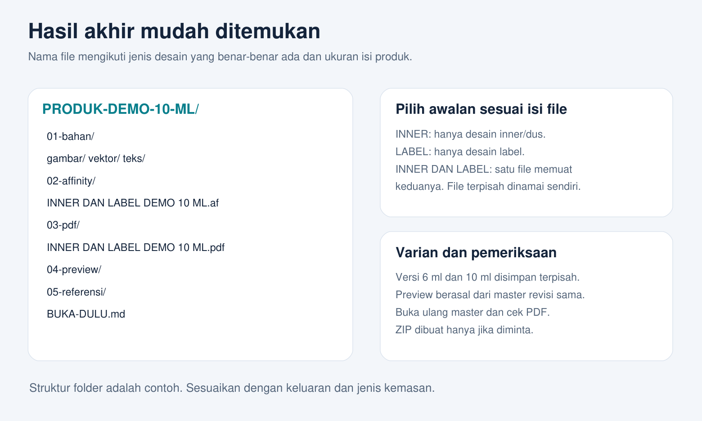

# 3. Alur pengerjaan dari awal sampai hasil

[Beranda](../README.md) · [Instalasi](02-instalasi-dan-koneksi.md) · [Contoh permintaan](04-contoh-dan-revisi.md)

## 1. Terima dan periksa sumber

Pengguna memberikan referensi, data produk, jenis kemasan dan target keluaran. Agent membuka gambar/file aktual, mencari revisi terbaru, lalu membaca ukuran dari rangka bila layout fisik diminta. Nama file `FINAL` saja tidak membuktikan versinya terbaru.

**Hasil tahap:** sumber yang dipakai dan batas pekerjaan jelas. Jika melanjutkan dokumen aktif, edit pengguna yang belum tersimpan perlu dipertahankan.

## 2. Pastikan keputusan yang memengaruhi desain

Agent memastikan jenis output, isi/varian, ukuran, produsen dan nomor registrasi yang relevan. Jika ada kolom produksi/kedaluwarsa, tentukan istilah lama atau baru. Pertanyaan hanya diajukan jika belum dijawab atau sumber saling bertentangan.

**Contoh pertanyaan:** “Acuan JPG memakai CV, sedangkan master memakai PT. Mana yang dipakai?” atau “Varian baru memakai ukuran fisik dan nomor TR yang sama?”

**Hasil tahap:** keputusan tercatat. Agent tidak menganggap waktu tunggu atau diam sebagai jawaban.

## 3. Analisis dan bagi komponen

| Komponen | Bentuk hasil yang sesuai |
| --- | --- |
| Informasi produk, petunjuk, produsen, angka isi | Teks editable, ditranskripsi dari sumber. |
| Foto, ilustrasi, pita, sapuan kuas | Aset terpisah; bitmap boleh dipakai untuk menjaga bentuk. |
| Logotype khusus | Aset asli atau rekonstruksi yang diberi catatan; jangan mengaku font persis jika belum terbukti. |
| Background, bar, kotak, garis, rangka | Bentuk native/SVG bila cocok. |
| Sertifikasi dan QR/barcode | Sumber pengguna/penerbit yang sesuai, bukan kode generatif. |

Tulisan yang terletak di dalam ilustrasi lingkaran tetap dapat dipisah sebagai teks. Jika batas objek, rongga transparan, atau elemen tumpang tindih belum jelas, agent menanyakan pembagiannya sebelum generate.

**Hasil tahap:** daftar komponen, sumber, metode dan target penempatan.

## 4. Siapkan semua bahan yang diperlukan

Ekstrak komponen asli bila tersedia. Bersihkan/pertajam atau rekonstruksi gambar bila diperlukan dan sesuai metode yang dipilih. Siapkan teks, motif, background dan warna. Simpan versi sumber.

Setiap aset dapat dicatat sebagai `source`, `extracted`, `reconstructed`, atau `unspecified`. Rekonstruksi AI dapat berbeda dari sumber; label tersebut membantu pengguna menilai kesetiaannya.

**Hasil tahap:** bahan gambar, teks dan bentuk terpisah. Pada pembuatan ulang dari gambar, agent belum sekadar menyimpan ulang master lama dan menyebutnya desain baru.

## 5. Periksa bahan sebelum digabung

Lihat logo, tepi dan detail pada ukuran penempatannya. Periksa transparansi pada luar objek serta rongga/celahnya; tidak boleh ada matte, bintik atau checkerboard yang ikut tercetak. Cocokkan nomor dan perusahaan dari sumber sampai aset.

**Hasil tahap:** bahan siap dipasang, atau revisi bahan yang spesifik. Bahan yang belum benar tidak ditutupi dengan layout baru.

## 6. Susun memakai rangka yang dipilih

Pertahankan geometri potong/lipat. Susun per bidang dengan teks dan bentuk editable sesuai kesepakatan. Logo, gambar dan QR tetap proporsional. Jika rasio berubah, atur jarak/kolom atau minta pilihan crop/reflow yang berpengaruh; jangan meregangkan seluruh desain.

Jika hanya panjang badan dus yang dikoreksi, sesuaikan panel dan flap terkait. Ukuran label tidak otomatis berubah. Jika meminta varian isi baru dengan “ukuran sama”, gunakan ukuran revisi terakhir yang disetujui.

**Hasil tahap:** master native baru/revisi, dengan sumber asli tetap tersedia.

## 7. Periksa hasil tersimpan

- Ukur bidang native dan PDF; jangan hanya membaca ukuran artboard.
- Cocokkan nama produk, isi, komposisi, perusahaan, nomor, dan format kolom.
- Periksa text overflow, elemen tertutup, logo terpotong, arah baca dan batas panel.
- Periksa proporsi dan pembacaan QR bila alat tersedia; QR persegi saja belum membuktikan bisa dipindai.
- Render/export setelah perubahan terakhir dan lihat gambar hasil.
- Buka ulang master bila perlu memastikan penyimpanan benar; jelaskan pemeriksaan yang belum bisa dilakukan.

**Hasil tahap:** hasil aktual telah diperiksa. Pemeriksaan artwork tidak menggantikan spesifikasi produksi atau uji cetak.

## 8. Serahkan folder dan tautan hasil

Berikan master, PDF/preview serta bahan sesuai permintaan, dengan indeks yang menunjukkan versi benar. Nama file mengikuti jenis desain yang ada. Varian lama tetap dipertahankan. ZIP dibuat hanya jika diminta.

Untuk uji ukuran fisik PDF, gunakan **Actual Size / 100%**. Opsi Fit to Page dapat mengubah hasil pengukuran cetak.

Revisi satu teks/aset tidak memerlukan generasi ulang seluruh bahan. Periksa serta perbarui hanya bagian dan keluaran yang terdampak.
